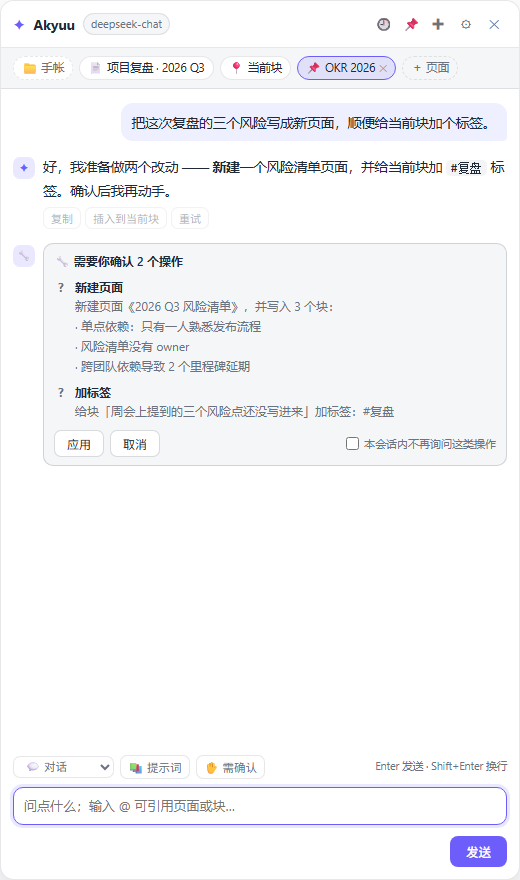
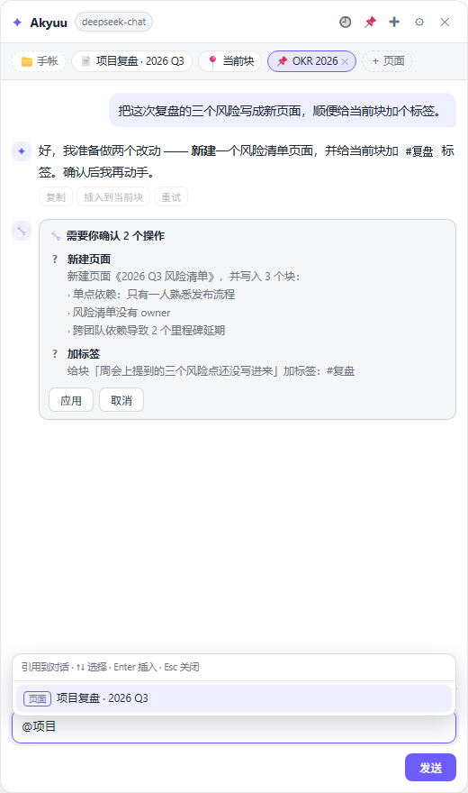
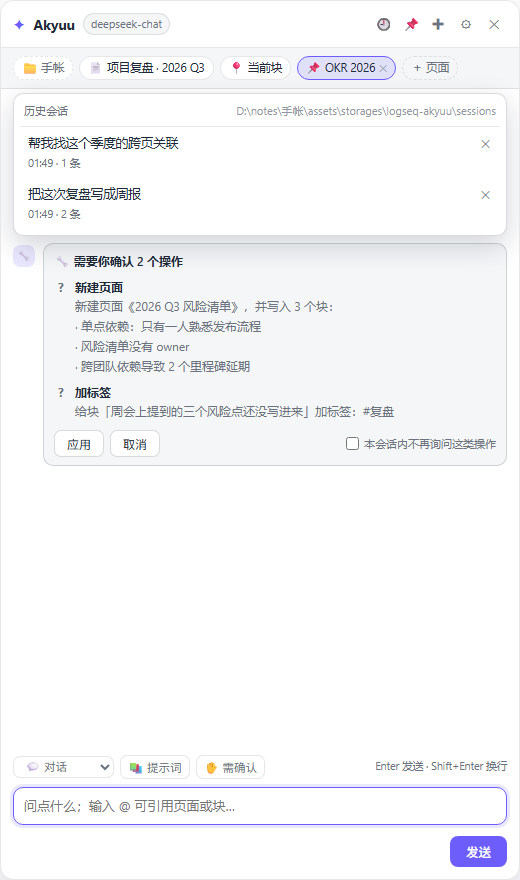

# Logseq Akyuu

**Akyuu** 是给 Logseq 用的 AI 助手 —— 面板里它自称 Akyuu，插件全名 Logseq Akyuu。它把 [obsidian-copilot](https://github.com/logancyang/obsidian-copilot) 的核心体验搬到了 Logseq：**侧边对话面板 + 自动带上图谱上下文 + 提示词快捷改写 + 流式输出 + 多模型供应商**，并且能**真的动手改你的笔记**（带确认），**会话存成图谱目录里的文件**。



## 它做了什么

| 能力 | Obsidian Copilot | Akyuu（本插件） |
| --- | --- | --- |
| 对话面板 | 右侧 sidebar view | 插件 main UI 浮层（`Ctrl/Cmd+Shift+J`） |
| 上下文 | 当前笔记 / 选区 / @ 引用笔记 | 当前页面 / 光标块 / 选中块 / 📌 引用页面 / @ 引用具体块 |
| 全库问答 | Vault QA（曾用向量索引，现已改为词法检索 + 可选语义后端） | 查询扩展 + BM25 + 图信号检索，零索引成本 |
| **动手改笔记** | 只输出文本，要你自己粘贴 | **工具调用**：建页 / 插块 / 改写 / 追加 / 移动 / 打标签 / 改 TODO / 页面属性 / 整页搬块 / 删页与恢复，动手前先给你看确认卡片 |
| 快捷改写 | Commands + 自定义 prompt | 命令面板 / 块右键 / `/akyuu` / 自定义提示词，结果直接写回块 |
| **会话存储** | 插件自己的 data 目录 | **你图谱目录里的 `sessions/` 文件夹**（`.json` 给插件读，`.md` 给人读） |
| 多模型 | OpenAI / Anthropic / Gemini / 本地 | 同上 + DeepSeek / OpenRouter / SiliconFlow / Moonshot / Ollama / LM Studio / 自定义 |
| 流式 + 中断 | ✅ | ✅（面板内可停止，写回块时边写边刷新） |
| 会话历史 | ✅ | ✅（🕘 列表，可切换 / 删除，最多 100 段） |

## 安装

### 方式一：加载未打包插件（开发用，推荐先这样试）

1. 设置 → 高级（Advanced）→ 打开 **开发者模式 / Developer mode**
2. 左侧边栏会出现 **插件 / Plugins** 页面，点右上角 **Load unpacked plugin**
3. 选择本目录（包含 `package.json` 的那一层）
4. 面板用 `Ctrl/Cmd + Shift + J` 唤起；也可以在命令面板搜 `Akyuu`

### 方式二：放进插件目录

把整个目录复制到 Logseq 配置目录下的 `plugins/`，例如：

- Windows：`C:\Users\<你>\.logseq\plugins\logseq-akyuu`
- macOS / Linux：`~/.logseq/plugins/logseq-akyuu`

重启 Logseq，在插件页启用即可。

> 插件没有构建步骤，`index.html` 直接引用 `src/*.js`。改完代码点插件卡片上的刷新按钮即可，不用重新 Load。

## 配置模型

设置 → 插件 → Logseq Akyuu：

| 设置项 | 说明 |
| --- | --- |
| 供应商 | 默认 `deepseek`；可选 `openai` / `siliconflow` / `moonshot` / `openrouter` / `ollama` / `lmstudio` / `anthropic` / `google` / `custom` |
| API Key | 只存在本机，随插件设置保存；本地模型留空 |
| 接口地址 baseUrl | 留空用供应商默认；自定义网关时填，例如 `https://your-gateway/v1` |
| 模型名 | 例如 `gpt-4o-mini`、`deepseek-chat`、`claude-3-5-sonnet-latest`、`gemini-2.0-flash` |
| 温度 / 最大输出 token | Anthropic 必须给 max tokens；其他供应商填 0 表示用默认 |
| 自动图谱检索 | 每次提问前在整张图里检索相关块（关掉更省钱、更快） |
| 智能查询扩展 | 先用小模型把问题扩成同义关键词和改写问法；关掉可省一次小请求（约 260 token） |
| 上下文字符上限 | 当前页 + 引用页 + 检索结果合计的预算，默认 6000 |
| 记住多少轮对话 | 默认 8 轮 |
| **允许操作 Logseq** | 关掉后它只能聊天、给建议，绝不写入任何块（最保险） |
| **写操作确认策略** | `confirm` 每次都问（默认）／`auto` 直接执行（删除仍需确认）／`off` 不给工具 |
| **工具调用协议** | `auto`＝能原生 function calling 的模型走原生，其余走文本协议；个别兼容模型不认 `tools` 时强制 `text` |
| **最多工具轮数** | 一次提问里最多连续几轮「工具往返」，默认 4（1~8）。超过就停手，发「继续」接着做 |
| 系统提示词 | 留空使用内置人格 |
| 回答语言 | `auto` / `zh` / `en` |
| 自定义提示词（JSON） | 见下 |
| 外观 | `follow` 跟随 Logseq 白天/暗夜（默认）／`light`／`dark` |
| 强调色（可选） | 留空＝跟随主题色（`--ls-link-text-color`）；也可填 `#106ba3` |
| 面板宽度 | 340~960 px |

**本地模型**：Ollama 预设是 `http://localhost:11434/v1`（OpenAI 兼容），模型名填 `qwen2.5:7b` 之类；LM Studio 同理。这两个不需要 Key。

## 使用

### 对话面板

- 唤起：`Ctrl/Cmd + Shift + J`，或命令面板 `Akyuu: 打开对话面板`，或搜索框旁的 ✦，或块里输入 `/akyuu`
- 面板可以**拖动标题栏移动**、**拖左边缘改宽 / 下边缘改高**、**双击标题栏复位**；位置和尺寸会记住（也存在本地，换图谱不变）
- 焦点在面板里时 `Ctrl/Cmd + Shift + J` 也能关闭（宿主快捷键在 iframe 内收不到，插件自己兜了一层）
- 上下文条会自动显示 `📄 当前页面` 和 `📍 当前块`，点击可临时关闭（划掉即不发）
- `＋ 页面` 可以搜索并引用其他页面（📌 加入上下文）
- **输入 `@` 可引用页面或块**：弹出搜索框，↑↓ 选择、Enter 插入；页面插入 `[[页面名]]`，块插入 `((uuid))`。发送时块内容会整段注入 `<pinned_blocks>`，模型看到的是内容而不是 uuid
- 模式：`💬 对话` 只带当前上下文；`📚 全图问答` 会加大检索强度
- 底部 `✋ 需确认` 按钮循环切换工具模式：`✋ 需确认` → `⚡ 自动执行` → `🚫 只能聊天`
- 右上角 `🕘` 打开历史会话列表（读的就是图谱目录里的会话文件，可切换、可删）
- 回答下方：`复制` / `插入到当前块` / `重试`
- 会话自动保存到图谱目录下的 `sessions/` 文件夹，重开 Logseq 会接着上次的对话
- 命令面板搜 **`Akyuu: 运行自检（环境与写入）`**：把「配置 / 当前页 / 当前块 / 图谱查询 / 检索 / 写回块 / 模型连通 / 工具链 / 工作区 / 主题跟随」10 项逐项跑一遍，在面板里出一份 Markdown 报告（会临时建两个 `Akyuu 自检 <时间>` 页面并删除，删除进的是 Logseq 的 Recycle，可恢复）
- 检索结果不对劲时，跑 **`Akyuu: 检索诊断（图谱查询）`**：报告图谱类型（DB 版 / 文件版）、块总数、`:block/content` 与 `:block/title` 各有多少块、实际用的正文键、回收站页面数、用当前页名做探测词的命中数、最近一次查询报错



### 让它动手改笔记（工具调用）

Akyuu 不只是给建议 —— 它可以调用下面这些工具真的改进图谱。默认策略下，**任何写操作都会先弹一张确认卡片**，你点「应用」才执行，点「取消」它就把这次操作当成被拒绝，继续用文字回答。

卡片右下角有个「**本会话内不再询问这类操作**」的勾选：勾上再应用，这个会话里同类操作（比如所有 `insert_block`）就直接执行、不再打扰你；**删除类不受影响**，永远会问。换新会话、切换历史会话、切换工具模式都会清空这个记忆。

| 工具 | 干什么 | 写 |
| --- | --- | --- |
| `list_pages` | 按关键词找页面名 | |
| `read_page` | 读整页块树（Markdown 缩进） | |
| `get_block` | 读单个块（含子块） | |
| `search_graph` | 整图块级检索，返回 uuid + 页面 + 摘要 | |
| `create_page` | 新建页面，可一次写入一组块（两个空格缩进＝子块） | ✅ |
| `insert_block` | 插块：块后 / 作为子块 / 页面末尾 | ✅ |
| `append_blocks` | 往页面末尾追加一组块 | ✅ |
| `update_block` | 整体改写某个块 | ✅ |
| `add_tags` | 给块加 `#标签`（已存在不重复） | ✅ |
| `set_todo` | 改 TODO / DOING / DONE / none | ✅ |
| `move_block` | 把块移到目标块的之前 / 之后 / 下面 | ✅ |
| `set_page_property` | 给页面设属性（`status:: 进行中`） | ✅ |
| `remove_page_property` | 删页面属性 | ✅ |
| `move_page_blocks` | 把 A 页的顶层块整批搬到 B 页 | ✅ |
| `delete_page` | 删整页（⚠️ 进 Recycle，可恢复） | ✅ |
| `restore_page` | 从 Recycle 恢复被删的页面 | ✅ |
| `delete_block` | 删块及其子块（⚠️ 永远需要确认） | ✅ |

「当前页 / 光标块」不用给 uuid：所有工具的 `uuid`、`page` 参数都接受 `current`，模型说「改光标这一块」就能对。

它可以干的活，举几个能直接试的：

```text
把这一页的内容整理成一个大纲，写到新页面《周报 11-01》里
把这段文字润色后替换掉光标块
给当前块加上 #复盘 和 #周会 标签
把「缓存雪崩预案」那条笔记的子块都标记成 DONE
在光标块后面插一条：下次评审带着方案来
```

工具调用有两条协议，插件会自己挑：

| 协议 | 什么时候用 | 怎么做 |
| --- | --- | --- |
| 原生 function calling | OpenAI 兼容接口 + 非推理模型（`deepseek-chat`、`gpt-4o-mini`、GLM、Qwen…） | 把工具 JSON Schema 直接发给模型，解析 `tool_calls` |
| 文本协议 | `deepseek-reasoner`、Anthropic、Gemini 等 | 提示词约定模型输出 ` ```akyuu ` JSON 代码块，插件解析后执行，再把 `<tool_results>` 回填给它 |

两条路最后都走同一张工具注册表、同一套确认卡片，所以行为一致；区别只在模型怎么表达「我要调用工具」。

**「最大工具轮数」是什么：** 一次提问里，模型可能反复「要工具 → 拿结果 → 再要工具」（比如先查页面、再建页面、再往里写块，就是 3 轮）。默认上限 4 轮、8 次调用，防止模型原地打转、也防止它一口气改太多东西。碰到上限时面板会追加一行「（已达到最大工具轮数 4：如果还有没做完的操作，发「继续」我就接着做）」—— 发一句 `继续` 就是新的一轮，计数器重置。两个相关的保护：同一批调用连续出现两次会立刻停（`已停止自动执行`），单次提问累计调用超过 8 次会忽略剩余请求。轮数可以在设置里调到 1~8。

**「文本协议」到底是什么意思？** 函数调用（function calling）是模型厂商提供的接口：插件把工具清单（JSON Schema）随请求发过去，模型回一个结构化的 `tool_calls` 字段，插件照着执行。但有些模型没有这个接口 —— `deepseek-reasoner` 明确不支持 `tools`，Claude / Gemini 用的又是另一套结构。于是插件准备了第二条路：**不靠接口，靠约定**。系统提示词里写清「要动手就单独输出一个 ```` ```akyuu ```` 代码块，内容是 `{"tool":"insert_block","args":{...}}`」，模型按这个格式写 Markdown，插件用正则把代码块抠出来、解析成同样的调用结构、执行，再把结果以 `<tool_results>` 包进下一轮消息，让它接着往下说。对模型来说这只是一段普通文本；代价是**依赖它守格式** —— 写歪了（比如直接在正文里写 JSON）就不执行，只给你文字。

**参数解析（踩过的坑）**：不同网关下发的 `arguments` 形态不一样 —— 标准是 JSON 字符串、有的直接给对象、有的弱模型把参数摊平在顶层（`{"tool":"create_page","name":"X"}`）。插件三种都认；如果一个调用连必填参数都凑不齐，**不会弹确认卡片、也不会写坏笔记**，而是直接把「缺什么」回喂给模型让它重试一轮（控制台会打印 `[akyuu] 工具参数不合法…`）。所以你只会看到最终结果，看不到「已执行 1 个操作 · 新建页面《？》」这种残废卡片。

### 工作区：图谱就是它的目录

会话不再是「插件内部数据」，而是**你图谱目录里的文件**：

```text
<你的图谱>/
└─ assets/storages/logseq-akyuu/sessions/
   ├─ index.json                          # 会话索引（标题/时间/条数）
   ├─ akyuu-session-20261101-091312-01.json  # 机器读：完整消息、来源、模型
   ├─ akyuu-session-20261101-091312-01.md    # 人读：直接当笔记看/拷进笔记
   └─ …
```

- 面板顶部的 `📁 图谱名` 就是当前工作区节点，悬停显示会话目录；命令面板 `Akyuu: 显示工作区与会话目录` 会出完整路径表
- 路径由 Logseq 宿主决定（插件不能自己挑绝对路径）。正常的桌面版 Logseq 会把 `Assets.makeSandboxStorage()` 指到 `<图谱>/assets/storages/<插件 id>/`；若你的版本不支持沙箱存储，会退化到 `~/.logseq/storages/`（所有图谱共用），再不行才用浏览器本地存储 —— 三种情况都会在报告里写明，不糊弄
- `.md` 会带上时间、图谱、模型，格式就是普通 Markdown，丢进 `pages/` 或 `journals/` 就能在 Logseq 里继续编辑
- 老版本存在浏览器里的会话会在首次启动时自动迁移成文件



### 外观：跟着 Logseq 的配色走

- **白天 / 暗夜**：读宿主的 `preferredThemeMode`，并订阅 `theme-mode-changed` 事件 —— 你在 Logseq 里切主题，面板立刻跟着切；宿主没给信息时用系统 `prefers-color-scheme` 兜底。
- **主题色**：插件跑在 iframe 里，CSS 变量不会跨文档继承，所以面板会把宿主根节点上的 `--ls-*` 变量（`--ls-primary-background-color`、`--ls-primary-text-color`、`--ls-link-text-color`、`--ls-border-color`、`--ls-font-family` …）读出来写进自己这边。**换自定义主题、换字体，面板都跟着变**；强调色直接取 `--ls-link-text-color`。
- 读不到宿主样式（跨域被拦）时，自动回落到内置的亮/暗两套色板，不会出现「白底白字」。
- 想固定风格：设置里「外观」选 `light` / `dark`，或填一个「强调色」覆盖主题色。
- 自检报告里有一行「主题跟随」，会写明当前是白天还是暗夜、有没有读到宿主色板、强调色是什么 —— 一眼就能判断是「跟着你的主题」还是「在用内置配色」。

### 快捷改写（结果直接写进笔记）

命令面板里搜 `Akyuu:`，或在块的右键菜单里选，或用 `/akyuu` 打开面板提问：

| 动作 | 作用范围 |
| --- | --- |
| 总结当前页面 | 整页 |
| 解释当前块 / 挑毛病 | 光标块 |
| 润色当前块 / 翻译当前块 / 续写当前块 | 光标块 |
| 生成大纲 / 提取待办 / 生成问答卡片 | 整页 |

执行时会**先在块下方插一个块，然后边生成边刷新内容**，完成后就是干净的最终文本，不需要手动复制粘贴。页面右键菜单里也能找到「总括此页面」。

### 自定义提示词

设置里的 `customPrompts`（JSON 数组），会自动出现在命令面板和块右键菜单：

```json
[
  {
    "label": "提炼成 3 条见解",
    "prompt": "把下面的笔记提炼成 3 条有洞察力的观点，每条一行：\n\n{{content}}",
    "target": "block"
  },
  {
    "label": "改写成推特串",
    "prompt": "把这一页改写成 5 条推文串，每条不超过 200 字：\n\n{{content}}",
    "target": "page"
  }
]
```

`{{content}}` 会被替换成目标块/页面的内容；`target` 取 `block`（默认）或 `page`。

## 针对 DeepSeek 与中文的优化

默认供应商就是 `deepseek`（`deepseek-chat` 或 `deepseek-reasoner`），并针对这两点做了五件事：

| 优化 | 说明 |
| --- | --- |
| 推理模型适配 | `deepseek-reasoner` 不传 `temperature`（它不支持），`max_tokens` 自动抬到 ≥8192，避免思维链把输出预算吃光 |
| 思维链可见 | 流式读取 `reasoning_content`，生成时显示「🧠 思考中… N 字」，结束后折叠成可展开的「思考过程」；**不会**回传历史（DeepSeek 要求不要把 `reasoning_content` 放回消息里） |
| 前缀缓存命中 | system 提示词固定不变（不放时间、不放检索结果），图谱上下文挪到**最后一条 user 消息**。同一会话里 system + 历史前缀因此保持稳定，DeepSeek 的自动上下文缓存能命中 |
| 中文查询扩展 | 扩展提示词要求「中文问题输出中文关键词」；兜底分词按 3-gram 优先、4-gram/2-gram 补充；停用词覆盖中文口语（「这一页」「帮我」「怎么」等） |
| 中文块引用 | `@` 搜索同时匹配页面名与块内容，块引用按 uuid 精确注入，不受分词影响 |

这些适配只在命中特征时生效（`reasoner` / `r1` 走推理分支），换 OpenAI、Claude、Gemini 或本地模型行为不变。

## 检索是怎么做的

没有向量索引，改成「查询扩展 → 召回 → BM25 → 图信号」四段式（思路来自 obsidian-copilot v3 的 `TieredLexicalRetriever`，实现是 Logseq 块查询版）：

```text
问题
 ├─ 保底命中：[[页面]] / #标签 / 📌 引用 → 整页注入 <pinned>，不参与打分
 └─ 检索
      1. expandQuery  小模型输出 3-6 个关键词 + 最多 3 个改写问法（失败则本地切词）
      2. recall       每个关键词一次 DataScript 查询，召回块 + 页面名命中
      3. rank         块级 BM25+：短语子串当 term，页面名命中 ×2.2
      4. boost        反向链接 ×1.08 / 当前页出链 ×1.06 / 同页聚团 ×1.03，封顶 ×1.18
      5. pick         min-max 归一化 + 多样性（同页最多 2 块，当前页 3 块）
```

几个刻意的设计：

- **扩展只用于召回，不参与打分**：改写问法只在关键词召回太少（< 3 块）时补一轮；BM25 始终用原问题的关键词，避免扩写把精度带偏。
- **正文键按图谱类型自动选**：DB 版图谱查 `:block/title`、文件版查 `:block/content`（探测一次后缓存）；关键词以 EDN 字面量直接内联进查询，不依赖宿主对 `:in` 入参的解析行为 —— 这两点都是「块数几万但检索恒为 0」的常见原因。
- **分段注入**：`<current_page>` / `<current_block>` / `<selection>` / `<pinned>` / `<graph_hits>` 分开包，模型能区分「用户明确要看的」和「我猜相关的」，不容易硬凑。
- **零状态**：不建索引、不写盘，所以没有「索引与笔记不同步」这类问题，换模型也不用重建。
- 每次提问的额外成本：一次约 260 token 的小请求 + 6 次 DataScript 查询；面板上的「检索 N 块（含扩展召回）」就是它的实际结果。

## 架构

```
index.html            插件入口（引用 SDK + 下面 9 个脚本）
src/md.js             小 Markdown 渲染器（纯字符串，可在 Node 里测）
src/store.js          轻量持久化：FileStorage → localStorage 兜底
src/llm.js            多供应商客户端 + SSE 流式解析 + 工具调用（原生 tool_calls / 文本协议）
src/retrieval.js      检索：查询扩展 / DataScript 召回 / BM25 / 图信号 / 多样性
src/context.js        上下文装配：分段注入（当前页/块/选中/保底/检索命中）
src/tools.js          工具注册表：17 个 Logseq 操作（读 4 / 写 13）+ 参数校验 + 预览文案
src/agent.js          多轮工具循环：调用 → 确认 → 执行 → 回填 → 再问（4 轮 / 8 次上限）
src/workspace.js      工作区：图谱信息 + 会话文件读写（assets 存储 → 插件存储 → 本地兜底）
src/panel.js          聊天面板 UI、工具确认卡片、历史会话、会话落盘
src/main.js           设置 schema、命令/菜单/斜杠注册、快捷改写写回块
preview.html          脱离 Logseq 的 UI 预览（假 logseq stub）
tools/make_icon.py    生成 icon.png
test/smoke.mjs        纯逻辑烟测
```

数据流：

```text
面板发问
  → retrieval 检索 → context.build() 拼分段上下文
  → agent.run()
       → llm.chatTurn()  原生 tool_calls 或 ```akyuu 文本
       → tools.preview() 生成人话预览 → 确认卡片
       → tools.run()     调 Editor API 改图谱
       → 结果回填 → 再问模型（最多 4 轮）
  → 渲染答案 / 写回块
  → workspace.saveSession() 写进图谱目录（.json + .md）
```

## 开发

```bash
node --check src/panel.js      # 语法检查
node test/smoke.mjs            # 80 条纯逻辑断言（Markdown / SSE / 切词 / BM25 / 动作解析 / 工具校验 / 会话格式）
python tools/make_icon.py      # 重新生成图标
```

改 UI 或交互时不用开 Logseq，三个无头检查就够（用 stub SDK + 假 fetch）：

```bash
CHROME="C:\Program Files\Google\Chrome\Application\chrome.exe"
# 1) 启动 + 命令/菜单/schema/工具注册
"$CHROME" --headless=new --dump-dom "file:///.../test/boot.html" | grep READY
# 2) 流式对话 + 上下文装配 + 快捷改写写回 + 工具确认执行 + 文本协议 + 会话落盘
"$CHROME" --headless=new --dump-dom "file:///.../test/chat.html" | grep CHAT
# 3) 面板外观截图（?theme=dark 深色、?sessions=1 会话列表、?mention=1 引用选择器）
"$CHROME" --headless=new --screenshot=preview-light.png --window-size=520,880 \
          "file:///.../preview.html"
```

`test/boot.html` 断言的是：17 条命令面板项、`/akyuu` 斜杠命令、6 个块菜单项、1 个页面菜单项、25 个设置项、17 个工具注册、工作区后端与目录、主题模式与色板来源、面板挂载成功、0 报错。

`test/chat.html` 断言的是：

- SSE 增量拼接、`reasoning_content` 单独捕获且不污染答案
- system 保持稳定而上下文在末条 user、分段注入（`<current_page>` / `<pinned>` / `<pinned_blocks>` / `<graph_hits>`）
- `@` 选择器插入 `[[页面]]` 与 `((uuid))`
- 快捷改写「插入占位块 → 流式刷新 → 最终文本」
- **原生工具链路**：请求带 `tools` → 流式 `tool_calls` 增量拼接 → 确认卡片 → 点「应用」前不写、点后写入 → 回填 `role:"tool"` → 二轮给出结论文本
- **本会话允许**：勾选「不再询问」再应用 → 同类操作第二次**不弹确认**、直接写入，删除类仍会问
- **参数容错**：`arguments` 是对象 / 被代码块包着 / 参数摊平在顶层 / JSON 被截断，都能正确解析或明确失败；参数不全时**不弹卡片**、自动回喂模型重试
- **文本协议链路**：换成 `deepseek-reasoner` 后请求不带 `tools`、system 带行动协议、`max_tokens=8192`、无 `temperature`，模型吐 ```` ```akyuu ```` 代码块被解析执行、代码块从正文里剥离、二轮回填 `<tool_results>`
- **主题**：跟随宿主 `preferredThemeMode`（暗夜/白天自动切）；「外观」强制 `dark` 生效、切回 `follow` 复位；色板来源可查询
- **工作区**：会话写入 `sessions/akyuu-session-*.json`、`.md` 是可读 Markdown、索引可列出、可按 id 读回

## 已知限制

- **不是向量 RAG**：检索靠「查询扩展 + BM25 + 图信号」，不做 embedding。好处是零索引、不会出现「索引与笔记不同步」；代价是同义改写依赖小模型的扩展质量，且每问现算——超大图（5 万块以上）单次提问的召回可能要 1-2 秒。真正的向量检索在路线图里，但它不是「加个函数」，而是一整套索引生命周期管理。
- **思维链不回传**：多轮对话里模型看不到自己上一轮的思考过程——这是 DeepSeek 的要求（回传 `reasoning_content` 会报错），不是 bug。
- **前缀缓存有条件**：只在「同一会话 + system 提示词没变 + 同一模型」时命中；改系统提示词或换模型会重新计费。
- **工具范围是「块 + 页面」**：块级能建/插/改写/追加/移动/打标签/改 TODO/删；页面级能设删属性、整页搬块、删页与恢复。改不了页面 schema、journal 模板、批量重构整图。每轮最多 4 次往返（可调到 1~8）、8 次调用，超过就停手，发「继续」接着做。
- **页面属性挂在第一个块上**：Logseq 的页面属性本质是首块的 `key:: value`，所以 `set_page_property` 会给空页面建一个空块来承载；不喜欢就手动删掉那个块。
- **整页搬块不会删源页面**：`move_page_blocks` 只搬块，A 页会剩一个空壳，要不要删由你决定。
- **没有撤销 API**：Logseq 插件 SDK 不暴露 undo，所以 `delete_block` 删除后只能靠 `Ctrl+Z`（编辑器历史）或 Recycle 找回；`delete_page` 走的是 Recycle 软删除，`restore_page` 能拉回来（需要较新的 Logseq，旧版会提示去 Recycle 页面手动恢复）。正因如此，删除类工具**永远需要确认**，`auto` 模式和「本会话不再询问」都不例外。
- **文本协议依赖模型听话**：`deepseek-reasoner` / Anthropic / Gemini 走的是「约定输出 ` ```akyuu ` 代码块」而不是原生 function calling。插件会把代码块从正文里剥掉，但模型偶尔仍会用别的形式表达意图（比如直接在正文里写 JSON），这时不会执行，只会给你文字 —— 换成 `deepseek-chat` 走原生协议最稳。
- **会话文件不在 Logseq 索引里**：`.json` / `.md` 在 `assets/storages/` 下，是普通文件，不会被当成页面（所以不会被你的全文检索命中）；想让它变成可搜索的笔记，把 `.md` 拷进 `pages/` 即可。
- **主题色是「尽量跟随」**：能读到宿主根节点的 CSS 变量就完全跟随（含自定义主题、字体）；如果宿主把插件 iframe 当跨域处理，就只能用内置的亮/暗色板 —— 自检里的「主题跟随」会告诉你属于哪种。
- **CORS**：面板在 iframe 里直接 `fetch` 模型接口。OpenAI / DeepSeek / OpenRouter / Gemini / Ollama 都放开了跨域；Anthropic 已带上 `anthropic-dangerous-direct-browser-access`。若用自建网关没开 CORS，会看到 `TypeError: Failed to fetch`。
- **快捷改写仍是单块多行**：一个回答写进一个块（Logseq 支持块内换行），不会自动拆成多个子块。要结构化拆分，就让它走工具（`append_blocks` / `create_page`）。
- **DB 版图谱已适配**：Logseq 的 DB 版图谱（图谱目录里是 `db.sqlite`）把块正文存在 `:block/title`，`:block/content` 在库里根本不存在；文件版（`pages/*.md`）才用 `:block/content`。插件会**探测一次**并据此切字段（自检「图谱查询」行会写明用的是哪个键、两种键各有几个块）。怀疑检索不对时，命令面板跑 **`Akyuu: 检索诊断（图谱查询）`**：直接列出图谱类型、块总数、`:block/content` / `:block/title` 的块数、实际使用的正文键、回收站页面数、探测词命中数和最近报错。
- **已删页面要自己过滤**：DB 版删页是软删除（库里留下 `:logseq.property/deleted-at` + `:logseq.property.recycle/original-page`），Logseq 界面和 Ctrl+K 会隐藏它们，但插件 API `Editor.getAllPages()` 的查询只过滤 `:logseq.property/hide?`、**不过滤 `deleted-at`**，所以已删页面照样会出现在 API 结果里。插件因此自己查一次 `:logseq.property/deleted-at` 得到回收站名单并排除：`list_pages` 不列、检索不召回、上下文不注入，`search_graph` 命中已删页面时会直接说「页面已被删除（在回收站里，可用 restore_page 恢复）」。
- 面板是浮层，不占位：它覆盖在正文右侧，宽度固定（设置里调）。没有做拖拽/分栏停靠 —— Logseq 插件 iframe 不支持自由停靠。

## 路线图

- [x] 多轮工具调用（读页面、写块、建页面、移动、打标签、改 TODO、删块）
- [x] 页面级工具（属性、整页搬块、删页 / 恢复页）
- [x] 本会话内「不再询问这类操作」
- [x] 会话落到图谱目录（`.json` + `.md`）
- [x] 跟随 Logseq 的主题色与白天/暗夜
- [ ] 可选的向量检索（embedding + 增量索引），在超大图上作为语义兜底
- [ ] 对话导出为 Logseq 页面 / 每日笔记（`.md` 已经在目录里，再加一个「拷进 pages/」按钮）
- [ ] 上架 marketplace

## License

MIT。灵感与产品形态来自 [logancyang/obsidian-copilot](https://github.com/logancyang/obsidian-copilot)（AGPL-3.0），本仓库为独立实现，未复用其代码。
